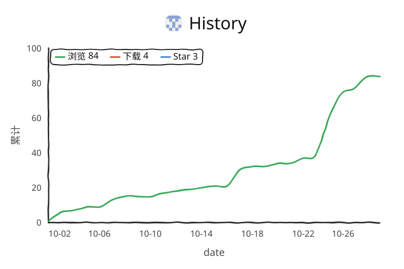

# 1024 Helper

在草榴站里日常逛帖子时，有些事重复得让人烦：点个赞、回一句、把帖子里的图存下来。
这组油猴脚本就是把这几件事包了起来 —— 装上之后，帖子页右下角会多一个小面板，剩下的交给它。

两个脚本，各干各的活：

| 脚本 | 作用 |
|---|---|
| `1024小助手-v1.9.user.js` | 主脚本。点赞、回复、下载、无图模式都在这里 |
| `1024回复采样器.user.js` | 可选。在后台慢慢收集帖子里的回复，喂给主脚本当回复库 |

## 主脚本能做什么

- 帖子页自动点赞
- 指定分区自动随机回复（目前只开了 `fid=2` 和 `fid=15`）
- 右下角一个回复面板，可以切换草稿、编辑词条、随时换一句
- 批量下载当前帖子的图片 / 视频
- 无图模式，纯看文字
- 自动跳过两种常见的拦路提示：
  - 「如果您的瀏覽器沒有自動跳轉」→ 直接进目标页
  - 「灌水預防機制已經打開，在 1024 秒內不能發貼」→ 退回来接着逛

## 回复采样器能做什么

它只在后台低频跑，干一件事：把指定分区里的回复抓下来，过滤掉明显的灌水和无意义内容，存进本地回复库。
主脚本的「换一句」就是从这里取词的。

用的时候建议单独开一个后台标签页让它慢慢跑，不要同时开一堆站内页面。

## 怎么装

用 Tampermonkey 就行：

1. 装 `1024小助手-v1.9.user.js`
2. 如果想让回复库更丰富，再装上 `1024回复采样器.user.js`

平时只开主脚本也完全够用。

## 面板上的按钮

| 按钮 | 干什么 |
|---|---|
| `回复` | 把当前草稿填进回复框 |
| `换一句` | 换下一条 |
| `List` | 查看 / 新增 / 编辑 / 删除回复词条 |
| `下载` | 批量下载本帖的图片和视频 |
| `无图` | 切换无图模式 |

## 数据存在哪

都在浏览器本地，不上传任何地方：

- `cl1024-reply-analytics-v1` —— 两个脚本共用的回复库
- `cl1024-reply-sampler-state-v1` —— 采样器自己的进度

清掉站点的 localStorage 就等于把这两个库清空。

## 一点说明

站点的页面结构改一次，脚本就可能需要跟着调一次。如果某个功能突然不灵了，多半是 DOM 变了，而不是脚本坏了。

## 免责声明

本项目仅供学习、交流与个人脚本研究使用。使用前请自行确认目标站点的规则、账号限制和相关风险。
因使用本项目导致的账号异常、限制、封禁或其他后果，由使用者自行承担。

## 访问量

<picture>
  <source media="(prefers-color-scheme: dark)" srcset="traffic/views-dark.svg" />
  <source media="(prefers-color-scheme: light)" srcset="traffic/views.svg" />
  
</picture>
